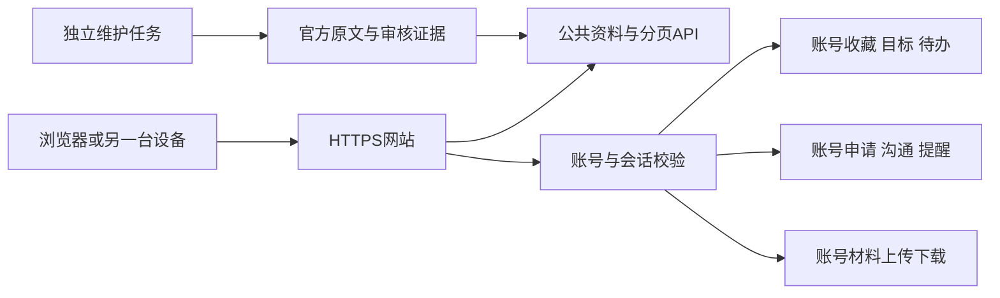

# 在线服务架构

只提供网站。学生免登录浏览公共信息，登录后访问按账号隔离的申请与材料；开发维护脚本不是学生的本机产品。2026-11-17修订；产品决策与验收见[在线服务说明](docs/ONLINE_SERVICE.md)。

## 账号与数据

`crawler/online_accounts.py` 使用SQLite保存用户名、独立盐的PBKDF2密码校验信息、会话摘要和收藏版本。密码不明文保存；服务端生成随机会话，HTTPS下使用Secure/HttpOnly/SameSite cookie。会话期限7天，退出吊销本会话，修改密码吊销其他会话。当前用户名不是经过验证的邮箱，不提供邮件找回。

`var/accounts/accounts.sqlite3` 保存账号、会话与收藏；`var/users/<账号ID>/` 保存该账号的工作流、旧联系记录和上传材料。账号ID来自有效会话，不由请求中的目录字段选择。私人接口要求登录，写操作要求同源及CSRF令牌；登录和注册限流。公网HTTP访问转到HTTPS，维护审核接口继续不公开。

`crawler/online_workspace.py` 只复用原工作流的明确业务入口，以账号目录覆盖私人文件位置；不挂载原单机静态服务器、不修改全局ROOT、不开放电脑目录扫描和公共资料更新写接口。原 `data/workflow.yaml` 等文件不自动迁移给任何新账号。

`crawler/online_materials.py` 将上传内容存到账号目录下的随机文件ID路径。浏览器不能传服务器绝对路径来注册或替换文件。下载鉴权并强制作为附件，不在静态站内内联执行。单文件20MB、每账号200MB；材料历史引用必须保留，删除行为须检查引用。文件类型不做可信认证，不提供病毒扫描。材料归属检查与存在性分开，文件缺失只标记对应材料，不阻断其余申请读取或上传。恢复校验传入备份，保留旧索引原始字节，不依赖旧索引可解析；备份不包含文件原件，缺失附件不能导出或冒充已恢复。

## 页面与状态

`site/templates/` 与共享 `ui.css` 控制页面。`account-session.js` 获取会话并为私人写操作添加CSRF令牌；`cloud-library.js` 管理账号收藏及版本冲突；账号数据不缓存到localStorage。原浏览器记录仅在用户明确预览确认后导入。

申请页将原导师数据、政策数据及四份业务脚本合为一个 `application-entry.js` 请求（原六份业务资源合一，不含共享账号脚本与样式）。构建先生成 `application-data.js`，再按数据、`admissions-core.js`、`material-actions.js`、`opportunities-core.js`、`workflow.js` 的既有执行顺序拼接；独立资源保留供其他页面使用。申请页导师投影保留所有记录的页面ID、姓名、学校和院系ID及名称，邮箱与研究方向仍由联系页加载。政策投影保留全部政策ID、目标匹配字段、摘要、适用条件、时间事件、官方来源和核验信息，保持筛选、条件判断、日期状态与来源质量等价。静态副本省去 `material_actions`；打开准备清单时由 `/api/workflow/material-tasks` 取得当前项目的动作、证据和私人准备记录，不据静态字段缺失判定没有材料要求。

正式申请沿用既有项目、材料、邮件草稿、沟通、提醒与准备清单模型，读取/写入使用账号工作流。每次修改在锁内读取并原子替换，账户之间文件分离。公开政策上下文按来源文件签名缓存并返回深拷贝；私人记录不使用共享内容缓存。YAML采用安全解析器，目录ID在单请求内复用。收藏有revision冲突检查；工作流不具备实时多人协作或每字段冲突合并，同一字段并发修改需要回看最新保存结果。

筛选、滚动和对比等界面状态仍可留在当前浏览器；这些界面状态不等于云端申请数据。未保存表单不承诺跨设备恢复。登录返回原导师、活动或项目；退出/换账号不继续展示上个账号的内存数据。

## 公开资料与范围

`data/professors` 保存导师与出处；`admissions.yaml` 保存政策、适用范围、摘要、条件、材料动作和证据定位，`admissions_checks.json` 单独保存来源检查，`admissions_entries.yaml` 保存官方入口。来源访问成功不等于人工摘要已更新，入口也不等于已覆盖具体政策。

`notices.json` 是官方通知候选及其届别、渠道和阶段线索。`opportunities.json` 保留原有内容稳定ID，并以 `content_classification` 区分机构活动、导师招募、正式通知和待核验；`public_catalog` 只将机构活动放入公开列表的 `opportunities`，其他记录在 `other_contents` 保持旧链接可解析。`mentor_ids` 必须有身份依据，不能按同名绑定。分类门禁与原文、时效门禁共同决定发布；失效或待核验来源保留状态，不能默认转为开放报名。`data/coverage.json` 与 `coverage.html` 公开已整理单位及缺口。

`build_site.py` 从公开资料生成页面与分用途载荷：学校选择使用 `school-catalog.js`，普通导师浏览通过 `/api/mentor-candidates` 对完整公开索引查询、筛选和排序，首批及每次追加 20 位；对比通过 `/api/mentors` 按选中的 ID 取回至多五位。公共资源使用 ETag、最长 300 秒缓存与 HTML 重验证，服务保持连接复用；切页不再统一加载完整导师及对比数据。分页响应包含目录 revision，翻页发现版本变化即重新加载首批；过期请求不覆盖新筛选结果。导师目录 API v2 与浏览器端公开索引回退共用一致的资格、职称及公开邮箱语义；旧项目目标和私人核验不参与过滤、排序。分页不可用时提示后回退。`email_source`/`email_source_date` 保留邮箱出处，`recruitment_labels` 从已确认身份关联派生。公共查询不包含项目 ID、材料路径或私人核验记录。`discovery-data.js`、完整搜索与对比载荷按所需流程延迟加载，网页、索引、导师详情及数据载荷应配套分发。字段未知、来源失败、内容变化与历史参考分别表达，不补默认资格或名额。

2026-11-16 的 v1.11.4 候选数据包含 74 项机会监测配置（72 个不同 URL）；本轮新增 12 项均完成官方父子页面核对和实际监测抓取。111 条政策的现有证据门禁均为 `checked`，但全部仍属于 2027 年度，并非 111 个当前报名机会，也不是 2028 届政策覆盖。原 67 条导师资料问题逐项处理为 46 条已解决、21 条保留待处理；这一批次不代表全库导师完成刷新。数量、适用年度和真实回源时间分别核对，不能用配置条数或构建日期替代来源成功与新鲜度。证据见[政策复检](docs/audits/2026-11-16/policy-revalidation.md)、[导师资料问题](docs/audits/2026-11-16/mentor-quality.md)及[机会来源](docs/audits/2026-11-16/opportunity-sources.md)；实际部署以本轮交付记录为准。

## 发现、核验与持续维护

`opportunity_monitor` 从配置的官方列表、受支持的公开 JSON API 或 `mode: direct_page` 招募正文发现候选，并持续检查已核验来源。单页源要求自定义标题与当前正文必须包含的 `required_text`，不同实验室使用独立稳定 `source_id`；关键招募语句撤下或来源不可读时保留旧记录并报错。它不把每个导师主页自动当作招生公告。首次基线不是“刚发布”。`opportunity_extract` 只生成保守建议及原文证据，保留月份精度，不把发布日期当作报名截止。

活动的 `application_window` 可记录有原文支撑的 `rolling` 或 `month` 窗口；活动状态分别为 `rolling`、`open_month`，不混入精确日期的 `open`。月份窗口只有明确开始且尚未到截止月才显示可申请，进入截止月为待确认、过月为结束；无依据不填月份或毕业届别。来源及人工核验时效门禁先于窗口展示。

`opportunity_review` 保存原始 HTML SHA、正文摘要、PDF 独立版本与页码证据。正式发布重新抓取来源，要求明确确认当前版本、核验人、说明及关键字段依据。PDF 使用 `source_documents` 记录 URL、SHA、页数、检查日期与字段摘录/页码；HTML 哈希不被 PDF 哈希替代。`source_attachments` 记录 DOCX 的官方 URL、SHA、检查日期以及字段摘录和段落/表格定位。只读取受限大小的 DOCX ZIP/XML 正文，不执行文档内容；附件须由当前同机构 HTTPS 官方公告链接，发布、续检和监测均重新验证。链接移除/增加、文件变化或解析失败会阻止发布/续检；已发布资料降为变化或待复核。HTML 正文与登记附件版本共同形成内容摘要，即使 HTML 不变也不能沿用已变化的附件。新条件必须重新核验。

`review_dashboard` 提供队列排序、原文和版本差异、编辑与阻塞原因；写入受维护服务的loopback Host/Origin、CSRF、JSON 大小和队列锁内版本比较保护。源页面按文本展示，不执行来源脚本。采纳、保存、发布是分开的操作。没有 OCR 时扫描件不能伪造可读正文。

`maintain_public.py` 每小时按政策源检查、政策证据再确认、导师轮转、资料问题处理、通知、机会续检及页面重建分阶段记录。政策再确认每轮至多 20 项，导师轮转及资料问题各至多 40 项。某一阶段失败不阻止其他独立阶段；部分来源失败也汇总为 `source_warnings`。维护和审核流水线不再生成客户端公共资料ZIP；网页和API直接使用服务器权威公共资料，不回源自身的旧客户端更新地址。当前申请单位优先占导师批次至多一半，至少另一半保留全量轮转机会，避免旧单位长期被饿死。

`policy_revalidation` 将政策字段摘要、登记来源和附件版本、配置及全部证据原句绑定。仅在这些内容一致时自动记录系统再确认，保留原人工摘要日期；默认 14 天后复检，网络错误按 2–48 小时退避，证据待复核项每天重看，配置或来源变化重新排队。新条件、变化附件和缺失原句不能靠刷新日期通过；前后端独立检查同一指纹，页面区分适用年度、人工日期和系统复检时间。

`mentor_quality` 将资料台账实际写入 `data/issues/`，从后续详情刷新错误新增问题，并扫描 NUDT 同名多登记及不同姓名共享简介邮箱。原台账曾未部署，不能再只依赖固定问题清单。已解决项每 7 天复检；未解决或错误项每 24 小时复检，后续刷新出现新失败可提前重开。状态及原文保存到 `cache/mentor_quality/`，自动处理不设置人工 `reviewed` 豁免。姓名和公开邮箱等身份依据不足时不迁移来源；同名记录不擅自合并，共享邮箱从自动个人字段撤回，解析器在日常刷新时继续阻止写回，人工字段保持。`legacy_refresh` 对不支持的详情按解析器/配置签名变化立即重试，否则每 7 天重试，避免永久跳过。

`quality_status` 从政策和导师的持久状态汇总问题、下一次检查和连续等待时间，按 24 小时维护时限接入既有维护通知；状态缺失或任务失败不能显示为全部健康。连续失败保留 `pending_since`，成功后重新失败才开始新的等待时钟。日常维护由服务器调度，不要求聊天代理在线；未知身份、官方矛盾或新政策语义仍需明确核验。

机会监测定时器每 15 分钟唤醒；按来源到期时间决定是否真正回源。默认当前单位或显式 current 来源 1 小时、普通 6 小时、历史 24 小时；配置可指定 1–168 小时间隔。每个域至少间隔 1 秒，失败指数退避至最多 48 小时。列表为空或从至少 10 条骤降到原数量的四分之一以下视为异常，保留旧记录并报警。`checked_at` 是调度时间，`last_fetch_at` 和逐源 `last_attempt` 才表示真实请求。是否启用及实际完成时间以服务记录为准。轮转检查不等于整库刷新，发现不等于核验发布，来源成功不等于学校正在受理。

公开活动状态判定对监测记录的 `next_check_at` 到期时间保留固定 15 分钟调度容差，避免秒级到期时间与整刻定时器之间的正常等待造成状态反复变化；超过容差仍未更新即降为待核验。容差只处理调度等待，监测已记录的来源失败、内容变化或缺少基线仍立即降级。来源成功检查不超过 7 天、事实复核不超过 30 天的独立门禁保持不变，报名截止时间也不因调度容差延后。

`pipeline_metrics` 汇总发现→核验→发布时间样本、待推进积压、最长等待和来源逾期；缺失历史时间保持未知，不倒填。分流仅写入绑定原文 SHA 的 triage 元数据，历史/无关项保留可查，不覆盖人工字段。

`automatic_review` 将严格规则、完整公开原文、AI 交叉核对和既有发布门禁组合为受限自动流程；无法自动处理时，`ai_evidence` 的逐字摘录仅写只读建议。人工已改字段不会被覆盖，旧事实变化必须复核，已核验且原文未变的合格条目 14 天后才可自动续核。默认无配置不调用 AI；密钥经服务端私有配置或 systemd credentials 提供，不进入公开页面、源码发布物或日志。

`source_discovery` 从已登记机会栏目、政策入口和院系主页有限展开同机构 HTML 栏目。发布模式下，明确的同机构 HTTPS 栏目可在父页仍有同名链接、栏目版本一致且存在独立活动公告时自动接入；跨机构、身份不明、非标准接口和版本变化保留待处理。接入栏目只增加监测，不发布活动。`review_queue` 基于真实正文证据排序，持久保存排队时钟和去重的超时/重新打开/解决事件。`run_review_pipeline.py` 分阶段串联发现、处理、提醒、在线页面重建、指标，页面阶段为 `public_pages`；一阶段失败不阻断独立阶段，重建失败不提前推进目录摘要。`maintenance_push` 将自愿维护订阅保存在独立目录，不读取申请用户的公共订阅或私人计划。具体门禁、间隔与故障处理见[自动核验说明](docs/AUTOMATIC_REVIEW.md)。

## 通知与外部动作

公共更新通知继续由服务器维护任务发送，用户须在浏览器主动订阅。账号同步不代表推送跨设备自动订阅；个人提醒是申请计划记录，目前不承诺后台推送个人截止。

邮件草稿由用户导出并在外部客户端实际发送；申请记录不向学校自动提交，系统不认证本人资格、名额、送达或录取。

## 部署、保护与恢复

学生只访问在线网站，不再发布本机运行包。旧下载接口、`/api/public-data` 与客户端资料归档入口关闭，旧local.html转到在线流程。开发用 `scripts/serve.py` 保留既有业务代码和测试用途，不作为用户分发入口。历史归档代码和报告可留作内部追溯，不构成公开兼容服务。

公共构建和维护只更新公共资料与网页，不读取账号目录。部署备份须覆盖程序和原有私有配置；上线后备份账号库与材料时应停止写服务取得一致快照，不能只拷SQLite主文件而遗漏事务或只备份材料索引。恢复后验证账号登录、项目关联和材料字节。当前未提供异地容灾或自助账号找回；具体部署、测试结果和运行限制见本轮交付记录。

## v1.11.6维护与首屏调整

`review_preflight`只写来源SHA、人工修订指纹绑定的机器分流，历史与导航不进入AI调用；人工分流优先。`automatic_evidence`绑定HTML及受支持附件，`policy_intake`只追加新范围政策，独立持久队列接入既有维护提醒。活动与政策AI、辅助摘录共享生产UTC日账本，失败也计数。详细规则见[自动核验说明](docs/AUTOMATIC_REVIEW.md)。

构建对start/discovery/admissions首屏内联共享样式、账号与业务脚本，其他页面沿用缓存资源；不缓存私人账号内容。活动页仅在线API首取，8秒未完成进入保守静态降级；静态加载另有8秒上限，保留重试入口。HTTP连接启用TCP_NODELAY；公网TCP连接偶发慢仍需独立计时，不能归因于前端资源。

## v1.11.7 分类、排队与资料补齐

`fetch.status=evidence_error` 表示已取得官方页面但图文或附件未完整核验，不进入失效URL恢复。`not_column` 表示未发现活动栏目，7天复查，可信父页变化可提前唤醒。旧图片公告只有标题日期时保留未知、降低优先级，不冒充完整历史核验。AI缓存同时绑定完整文本和提议字段版本，协议错误可重试，语义问题仍转人工。

`policy_intake` 发现候选即登记首次发现时间，未经尝试也进入等待统计；有新鲜官方证据的历史政策排除出当前处理SLA。导师全库字段扫描另存 `cache/mentor_quality/field-gaps.json`，与网络错误分账；每小时专项最多6人/12次请求，普通40人轮转保留最多四分之一给字段缺口，复用24小时证据。未检查库存按队列展示，不全部套24小时超时；已检查待适配问题、计划复检未运行单独计算，官网未公开字段30天复看，不从论文或常识推断资格。

完整附件核验扩展到受限DOC和XLSX；DOC由服务账号调用限时、限资源antiword，XLSX保留单元格位置；宏、加密、嵌入对象、不确定公式或布局等无法验证内容不自动发布。固定CMS附件图标只有与实际官方附件明确绑定时才可忽略。部署依赖与异常状态核查见[运行环境记录](docs/audits/2026-11-17-v1117/dependency-operations.md)。

院校活动页也内联首屏依赖，仍以公开API加载最新活动。导师请求和已保存申请读取有8秒上限，失败释放控件、保留已读内容并允许重试；导师超时不立即下载全量索引。账号会话恢复必须同时恢复后续CSRF保护写操作，不能仅以GET恢复证明可继续保存。真实加载时间和线上申请验证以本轮交付实测为准。
