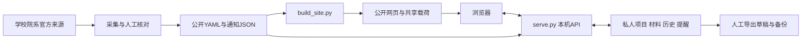

# v1.0 当前架构

公开资料与静态站、本机私人工作流、维护采集相互分离。本版交付现有能力，停止新增扩充。

## 公开层

data/professors按学校/院系登记导师和出处，缺失不脑补，同名不自动合并。schools和sites界定范围；admissions保存范围、摘要、quote/locator、review_hashes、条件和材料动作，checks单独保存成功/失败和时间，入口不等于已整理政策。

来源支持HTML、PDF、JSON内嵌HTML，以及明确同源API/JSON请求体的结构化POST；后者指纹绑定API、方法、参数、指针及内容。旧GET指纹/缓存保持，自动回源不自动改人工摘要。通知仍为候选。

build_site生成data.js/search.js/compare-data.js/admissions-data.js及页面，全文和政策按需加载。静态浏览不依赖私人文件，保存、跟进及版本核对需本机API。

## 本机层

serve.py仅监听127.0.0.1，提供workflow/discovery及旧outreach API。私人写入有本机Host/Origin、JSON校验、锁和原子替换。静态根为site，私人data与原材料不作为静态目录发布。

workflow_util管理项目/材料/沟通/提醒；contact_util增加联系目标、草稿、实际已发快照；project_util提供8字段目标及官方日期快照；project_review_util分别记录本项目机会与本人资格人工证据。

material_task_util提供v4包装及v3兼容投影。latest同时匹配project、完整goal和action fingerprint；来源或文件变化产生复核。读取不迁移，明确保存追加历史。阶段/状态筛选只渲染，不重排原API数组；提交/提醒保留原始索引。discovery支持备份1/2；候选比较及部分视图偏好在localStorage，与文件备份分开。

## 时间与外部动作

项目待办和事件明确按北京时间处理日期边界，日期级不补时刻，精确时间要求时区；同日混合精度保留登记顺序。不应笼统称全部日期判断统一时区：部分质量判断用浏览器日期，部分后端用主机date.today。

EML由用户在外部客户端发送后再记录；材料prepared/submitted为人工登记，不上传。保存官方日期不自动创建提醒。没有后台推送、官网代报名或自动发信。

## 分发

运行ZIP带公开数据、site、配置、必要Python模块、serve/build和文档；解释器/依赖另装。排除私人文件、真实材料、缓存、sources与Git历史。MANIFEST.json记录逐文件SHA256及来源提交。架构不能保证资料新/全、导师当前名额、本人资格或申请结果，参见REQUIREMENTS和RELEASE_ACCEPTANCE。
