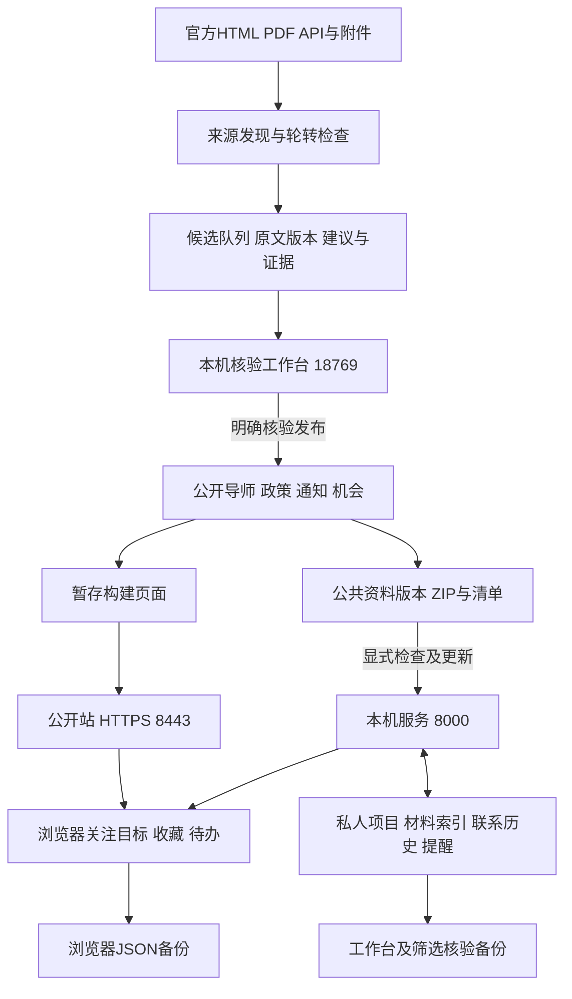

# 架构 · v1.5.0

系统分为公开资料、浏览器个人记录、本机正式申请、维护核验四个边界。公开站不读取本机私人工作流，公共资料更新不承担私人记录迁移。

## 入口与路径

`start.html` 区分 2027 入学统考与 2028 届毕业保研准备，按学校、兴趣和年份连接导师、政策、通知及活动。活动年、毕业届别、入学年分别保存；标题或发布时间不能替代申请对象。

公开站根路径跳转 `start.html`，由 `scripts/serve_public.py` 提供公开查询、资料版本下载及自愿通知订阅。公开站拒绝 `review.html`、`review.js`，不注册核验或私人工作流写接口。HTTPS 对外入口使用 8443，具体服务部署结果见本版交付记录。

本机 `scripts/serve.py` 默认绑定 `127.0.0.1:8000`，提供静态站、私人申请 API 与明确触发的公共资料更新。核验台由独立 `scripts/serve_review.py` 固定绑定 `127.0.0.1:18769`，不接入公网服务。

## 公开资料与范围

`data/professors` 保存导师与出处；`admissions.yaml` 保存政策、适用范围、摘要、条件、材料动作和证据定位，`admissions_checks.json` 单独保存来源检查，`admissions_entries.yaml` 保存官方入口。来源访问成功不等于人工摘要已更新，入口也不等于已覆盖具体政策。

`notices.json` 是官方通知候选及其届别、渠道和阶段线索。`opportunities.json` 是明确核验的活动目录；失效或待核验来源保留状态，不能默认转为开放报名。`data/coverage.json` 与 `coverage.html` 公开已整理单位及缺口。

`build_site.py` 从公开资料生成页面与共享载荷；网页、导师详情及相关数据载荷应配套分发。字段未知、来源失败、内容变化与历史参考分别表达，不补默认资格或名额。

## 发现、核验与持续维护

`opportunity_monitor` 从配置的官方栏目发现候选，并持续检查已核验来源；首次基线不是“刚发布”。`opportunity_extract` 只生成保守建议及原文证据，保留月份精度，不把发布日期当作报名截止。

`opportunity_review` 保存原始 HTML SHA、正文摘要、PDF 独立版本与页码证据。正式发布重新抓取来源，要求明确确认当前版本、核验人、说明及关键字段依据。PDF 使用 `source_documents` 记录 URL、SHA、页数、检查日期与字段摘录/页码；HTML 哈希不被 PDF 哈希替代。文件变化或失败阻止自动续检，新条件必须重新核验。

`review_dashboard` 提供队列排序、原文和版本差异、编辑与阻塞原因；写入受本机 Host/Origin、CSRF、JSON 大小和队列锁内版本比较保护。源页面按文本展示，不执行来源脚本。采纳、保存、发布是分开的操作。没有 OCR 时扫描件不能伪造可读正文。

`maintain_public.py` 将政策、导师、通知、续检、页面重建及公共资料版本生成分阶段记录。某一阶段失败不阻止其他独立阶段；页面构建失败时不生成新的公共资料版本。当前申请单位优先占导师批次至多一半，至少另一半保留全量轮转机会，避免旧单位长期被饿死。

默认任务周期为六小时，是否启用及实际完成时间以服务记录为准。轮转检查不等于整库刷新，发现不等于核验发布，来源成功不等于学校正在受理。

## 公共资料版本更新

`crawler/public_snapshot.py` 为明确白名单中的公开资料生成 ZIP、版本 ID 和清单，包含 schema、客户端版本、归档及逐文件 SHA-256。私人工作流、学生画像、信件、材料原件和密钥不在归档路径白名单中。

`crawler/public_update.py` 通过配置的可信 HTTPS 站点检查版本；用户明确触发后下载，并验证归档/逐文件摘要、schema、完整清单、路径白名单和客户端版本一致性。代码不从资料包更新：使用本机代码、模板在暂存目录构建页面，成功后才替换公开资料和生成页面。

旧文件转存 `cache/public_updates/backup-<版本前16位>/`。替换异常按已执行路径逆序恢复；下载、校验或构建失败不进入替换。安装记录为 `cache/public-data-installed.json`。这是带备份回滚的逐路径更新，不是整个目录在同一瞬间切换；操作期间应避免并行手工维护和未保存编辑。

## 浏览器记录与正式申请

`browser-library-core.js` 管理当前浏览器、当前 origin 下的关注目标、收藏和待办；不上传服务器，不自动创建正式项目。导出为独立 JSON，导入先预览，确认后仅合并新增条目。其计划日期只供页面排序，不产生后台提醒。

本机 `workflow_util`、`contact_util`、`project_util`、`project_review_util` 与 `material_task_util` 管理正式项目、8 字段目标、材料索引及版本、邮件草稿、明确已发快照、沟通历史、多提醒和人工准备记录。活动快照是项目的可选字段，公共资料更新不会覆盖它。

私人写入通过本机 API 的校验、锁及原子替换完成。读取兼容旧数据不主动迁移，明确保存/恢复才写入。工作台恢复替换相应文件且先备份，不是浏览器备份的合并策略。材料原件、学生画像、SOP、独立信件和浏览器记录不自动进入工作台备份。

## 通知与外部动作

公共活动支持 HTTPS 浏览器自愿订阅、测试和退订；推送依赖服务器任务、浏览器、操作系统及推送服务。它与本机个人提醒、浏览器待办分开，不上传个人申请内容。

EML 由用户在外部邮件客户端实际发送后再登记；人工准备/提交记录不向学校上传。系统不认证本人资格、当前导师名额、送达或录取结果。

## 分发与证据

运行包通过白名单分发公开资料、网页、必要代码和说明，Python 与依赖另装；不包含真实私人资料、原材料、维护缓存或 Git 历史。程序升级采用新目录及独立备份恢复，不能用旧 `data` 整目录覆盖新版公共资料。

本版验证和部署事实统一见 [v1.5 交付记录](deploy/DELIVERY_V1.5_2026-11-15.md)。旧架构原文位于 [pre-v1.5 历史备份](docs/history/pre-v1.5/ARCHITECTURE.md)。
