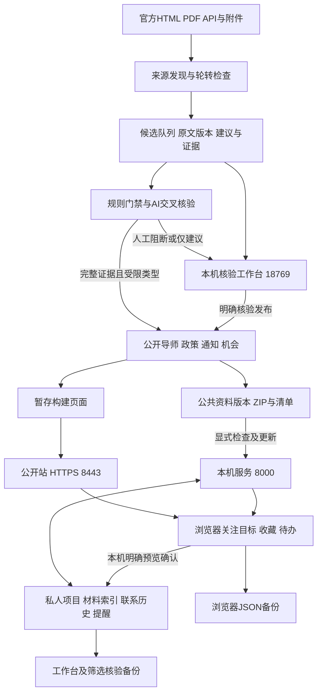

# 架构 · v1.8.0

系统分为公开资料、浏览器个人记录、本机正式申请、维护核验四个边界。公开站不读取本机私人工作流，公共资料更新不承担私人记录迁移。

## 入口与路径

`start.html` 区分 2027 入学统考与 2028 届毕业保研准备，按学校、兴趣和年份连接导师、政策、通知及活动。活动年、毕业届别、入学年分别保存；标题或发布时间不能替代申请对象。

公开站根路径跳转 `start.html`，由 `scripts/serve_public.py` 提供公开查询、资料版本下载及自愿通知订阅。公开站拒绝 `review.html`、`review.js`，不注册核验或私人工作流写接口。HTTPS 对外入口使用 8443，具体服务部署结果见本版交付记录。

本机 `scripts/serve.py` 默认绑定 `127.0.0.1:8000`，提供静态站、私人申请 API 与明确触发的公共资料更新。核验台由独立 `scripts/serve_review.py` 固定绑定 `127.0.0.1:18769`，不接入公网服务。

## 公开资料与范围

`data/professors` 保存导师与出处；`admissions.yaml` 保存政策、适用范围、摘要、条件、材料动作和证据定位，`admissions_checks.json` 单独保存来源检查，`admissions_entries.yaml` 保存官方入口。来源访问成功不等于人工摘要已更新，入口也不等于已覆盖具体政策。

`notices.json` 是官方通知候选及其届别、渠道和阶段线索。`opportunities.json` 是明确核验的活动目录；失效或待核验来源保留状态，不能默认转为开放报名。`data/coverage.json` 与 `coverage.html` 公开已整理单位及缺口。

`build_site.py` 从公开资料生成页面与分用途载荷：学校选择使用 `school-catalog.js`，普通导师浏览通过 `/api/mentor-candidates` 对完整公开索引查询、筛选和排序，首批及每次追加 20 位；对比通过 `/api/mentors` 按选中的 ID 取回至多五位。公共资源使用 ETag、最长 300 秒缓存与 HTML 重验证，服务保持连接复用；切页不再统一加载完整导师及对比数据。分页响应包含目录 revision，翻页发现版本变化即重新加载首批；过期请求不覆盖新筛选结果。项目范围或私人核验参与判断时，回到本机 `discovery-core.js` 及完整公开资料计算；分页不可用也允许显式提示后回退。公共查询不包含项目 ID、材料路径或私人核验记录。`discovery-data.js`、完整搜索与对比载荷按所需流程延迟加载，网页、索引、导师详情及数据载荷应配套分发。字段未知、来源失败、内容变化与历史参考分别表达，不补默认资格或名额。

v1.7 基线数据登记 18 条机会，运行规则状态为 `open:1`、`open_month:1`、`rolling:6`、`upcoming:1`、`review:1`、`closed:8`。监测配置 61 项：列表 51、API 4、招募单页 6；已登记机会中 1 条绑定 DOCX、1 条绑定 PDF。数量由 `docs/DATA_SNAPSHOT.json` 从公开文件重算，不用配置数量替代来源请求成功数。

## 发现、核验与持续维护

`opportunity_monitor` 从配置的官方列表、受支持的公开 JSON API 或 `mode: direct_page` 招募正文发现候选，并持续检查已核验来源。单页源要求自定义标题与当前正文必须包含的 `required_text`，不同实验室使用独立稳定 `source_id`；关键招募语句撤下或来源不可读时保留旧记录并报错。它不把每个导师主页自动当作招生公告。首次基线不是“刚发布”。`opportunity_extract` 只生成保守建议及原文证据，保留月份精度，不把发布日期当作报名截止。

活动的 `application_window` 可记录有原文支撑的 `rolling` 或 `month` 窗口；活动状态分别为 `rolling`、`open_month`，不混入精确日期的 `open`。月份窗口只有明确开始且尚未到截止月才显示可申请，进入截止月为待确认、过月为结束；无依据不填月份或毕业届别。来源及人工核验时效门禁先于窗口展示。

`opportunity_review` 保存原始 HTML SHA、正文摘要、PDF 独立版本与页码证据。正式发布重新抓取来源，要求明确确认当前版本、核验人、说明及关键字段依据。PDF 使用 `source_documents` 记录 URL、SHA、页数、检查日期与字段摘录/页码；HTML 哈希不被 PDF 哈希替代。`source_attachments` 记录 DOCX 的官方 URL、SHA、检查日期以及字段摘录和段落/表格定位。只读取受限大小的 DOCX ZIP/XML 正文，不执行文档内容；附件须由当前同机构 HTTPS 官方公告链接，发布、续检和监测均重新验证。链接移除/增加、文件变化或解析失败会阻止发布/续检；已发布资料降为变化或待复核。HTML 正文与登记附件版本共同形成内容摘要，即使 HTML 不变也不能沿用已变化的附件。新条件必须重新核验。

`review_dashboard` 提供队列排序、原文和版本差异、编辑与阻塞原因；写入受本机 Host/Origin、CSRF、JSON 大小和队列锁内版本比较保护。源页面按文本展示，不执行来源脚本。采纳、保存、发布是分开的操作。没有 OCR 时扫描件不能伪造可读正文。

`maintain_public.py` 将政策、导师、通知、续检、页面重建及公共资料版本生成分阶段记录。某一阶段失败不阻止其他独立阶段；阶段部分来源失败也汇总为 `source_warnings`，与致命失败一起进入维护告警。页面构建失败时不生成新的公共资料版本。当前申请单位优先占导师批次至多一半，至少另一半保留全量轮转机会，避免旧单位长期被饿死。

机会监测定时器每 15 分钟唤醒；按来源到期时间决定是否真正回源。默认当前单位或显式 current 来源 1 小时、普通 6 小时、历史 24 小时；配置可指定 1–168 小时间隔。每个域至少间隔 1 秒，失败指数退避至最多 48 小时。列表为空或从至少 10 条骤降到原数量的四分之一以下视为异常，保留旧记录并报警。`checked_at` 是调度时间，`last_fetch_at` 和逐源 `last_attempt` 才表示真实请求。是否启用及实际完成时间以服务记录为准。轮转检查不等于整库刷新，发现不等于核验发布，来源成功不等于学校正在受理。

`pipeline_metrics` 汇总发现→核验→发布时间样本、待推进积压、最长等待和来源逾期；缺失历史时间保持未知，不倒填。分流仅写入绑定原文 SHA 的 triage 元数据，历史/无关项保留可查，不覆盖人工字段。

`automatic_review` 将严格规则、完整公开原文、AI 交叉核对和既有发布门禁组合为受限自动流程；无法自动处理时，`ai_evidence` 的逐字摘录仅写只读建议。人工已改字段不会被覆盖，旧事实变化必须复核，已核验且原文未变的合格条目 14 天后才可自动续核。默认无配置不调用 AI；密钥经服务端私有配置或 systemd credentials 提供，不进入页面、发行包或日志。

`source_discovery` 从可信入口有限展开同机构 HTML 栏目，新栏目必须明确核准接入。`review_queue` 基于真实正文证据排序，持久保存排队时钟和去重的超时/重新打开/解决事件。`run_review_pipeline.py` 分阶段串联发现、处理、提醒、页面与公开资料重建、指标；一阶段失败不阻断独立阶段，重建失败不提前推进目录摘要。`maintenance_push` 将自愿维护订阅保存在独立目录，不读取申请用户的公共订阅或私人计划。具体门禁、间隔与故障处理见[自动核验说明](docs/AUTOMATIC_REVIEW.md)。

## 公共资料版本更新

`crawler/public_snapshot.py` 为明确白名单中的公开资料生成 ZIP、版本 ID 和清单，包含 schema、客户端版本、归档及逐文件 SHA-256。私人工作流、学生画像、信件、材料原件和密钥不在归档路径白名单中。

`crawler/public_update.py` 通过配置的可信 HTTPS 站点检查版本；用户明确触发后下载，并验证归档/逐文件摘要、schema、完整清单、路径白名单和客户端版本一致性。代码不从资料包更新：使用本机代码、模板在暂存目录构建页面，成功后才替换公开资料和生成页面。

旧文件转存 `cache/public_updates/backup-<版本前16位>/`。替换异常按已执行路径逆序恢复；下载、校验或构建失败不进入替换。安装记录为 `cache/public-data-installed.json`。这是带备份回滚的逐路径更新，不是整个目录在同一瞬间切换；操作期间应避免并行手工维护和未保存编辑。

## 浏览器记录与正式申请

`browser-library-core.js` 管理当前浏览器、当前 origin 下的关注目标、收藏和待办；不上传服务器，不自动创建正式项目。导出为独立 JSON，导入先预览，确认后仅合并新增条目。浏览器计划日期本身只供页面排序，不产生后台提醒。本机 `/api/workflow/browser-transfer` 在显式预览确认后复用工作流 schema 建项目，按稳定 ID 去重、保留已有人工编辑；仅关联目标的有日期待办转为个人提醒，无日期项保留备注。公开站不注册此接口。机会快照由服务端现有目录读取，不能相信浏览器提交的资格或截止。

本机 `workflow_util`、`contact_util`、`project_util`、`project_review_util` 与 `material_task_util` 管理正式项目、8 字段目标、材料索引及版本、邮件草稿、明确已发快照、沟通历史、多提醒和人工准备记录。活动快照是项目的可选字段，公共资料更新不会覆盖它。

私人写入通过本机 API 的校验、锁及原子替换完成。读取兼容旧数据不主动迁移，明确保存/恢复才写入。工作台恢复替换相应文件且先备份，不是浏览器备份的合并策略。材料原件、学生画像、SOP、独立信件和浏览器记录不自动进入工作台备份。

## 通知与外部动作

公共活动支持 HTTPS 浏览器自愿订阅、测试和退订；每 15 分钟调度，语义字段规范化后比较，忽略空白与独立列表顺序差异。聚合记录包含任务时间、服务接受时间及发布至发送延迟；不表示浏览器已显示。推送依赖服务器任务、浏览器、操作系统及推送服务。它与本机个人提醒、浏览器待办分开，不上传个人申请内容。

EML 由用户在外部邮件客户端实际发送后再登记；人工准备/提交记录不向学校上传。系统不认证本人资格、当前导师名额、送达或录取结果。

## 分发与证据

运行包通过白名单分发公开资料、网页、必要代码和说明，Python 与依赖另装；不包含真实私人资料、原材料、维护缓存或 Git 历史。程序升级采用新目录及独立备份恢复，不能用旧 `data` 整目录覆盖新版公共资料。

本版验证和部署事实统一见 [v1.8 交付记录](deploy/DELIVERY_V1.8_2026-11-15.md)。旧架构原文位于 [pre-v1.8 历史备份](docs/history/pre-v1.8/ARCHITECTURE.md)。
