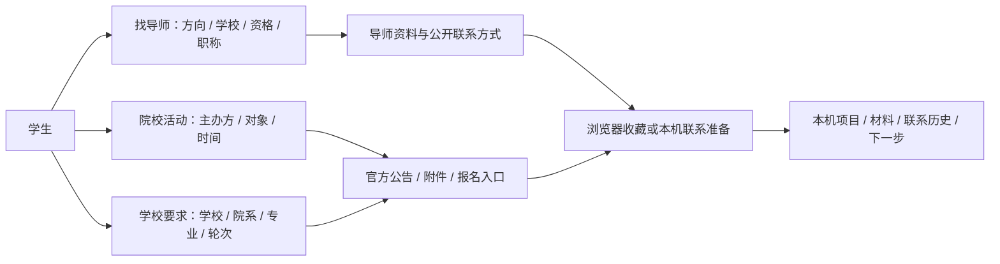
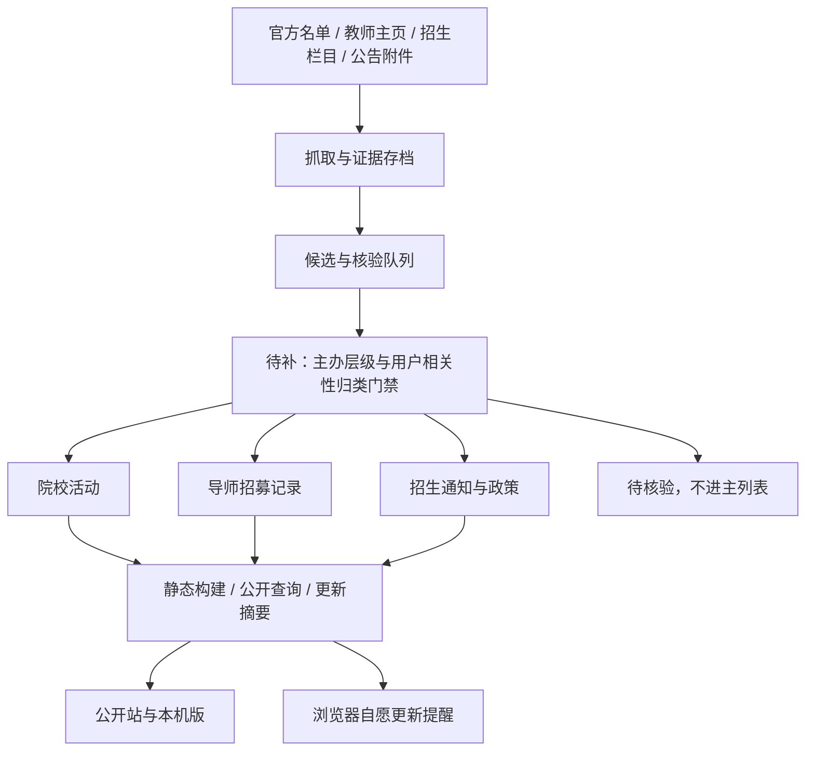

# 项目地图

整理日期：2026-11-15；运行基线：v1.9.0，`aecb478e7`。**本文描述现状及整改位置，不表示整改已经实现。** 本轮先形成文档基线，产品代码、资料和部署保持原状。

## 产品究竟服务什么任务

CS 学生需要完成三类决定：找谁联系、参加什么院校活动、为哪个学校/专业准备什么。系统负责提供能追溯的公开事实，并保存用户明确操作的申请进展。采集数量、后台功能数量、测试通过数量不代替这三个任务的完成。

图中导师筛选及活动边界是本次目标。当前运行版仍有目标学位、私人核验筛选，以及个人招募混入活动页的问题。对应规则以 [需求](REQUIREMENTS.md)、[用况](docs/USE_CASES.md) 为准。

## 页面地图

| 页面 / 用户入口 | 应承担的单一主要任务 | 现状问题与整改范围 | 主要实现 |
| --- | --- | --- | --- |
| 申请导航 `start.html` | 首访选路径；回访继续已关注内容 | 目标、收藏、更新维护信息混杂；精简默认内容，不新增仪表盘 | `start.js`、`browser-library*.js`、`plan-transfer.js` |
| 找导师 `discovery.html` | 按真实导师属性找出愿意进一步了解的人 | 学位偏好被误当硬筛选；缺邮箱仍出现；卡片不齐 | `discovery.js`、`discovery-core.js`、`crawler/public_discovery.py` |
| 导师资料 `p/*.html` | 判断研究交集，取得联系人与原始依据 | 长介绍、来源和招募事实需清晰分层；个人实习招募归此 | `detail.html.j2`、`crawler/model.py` |
| 导师对比 `compare.html` | 比较已选导师的方向、资格和联系信息 | 不推断个人资格、名额或录取概率；手机也要能比较 | `compare.html.j2`、`crawler/public_catalog.py` |
| 保研机会 `opportunities.html` | 查看学校/院系/研究所组织的营和正式院所项目 | 个人招募混入；主办方、发布时间与核验状态不直观 | `opportunities*.js`、`crawler/opportunity_util.py` |
| 学校与要求 `admissions.html` | 核对当前目标条件、材料、截止与适用范围 | 摘要截断不等于有效概括；不能把关键限制全藏起 | `admissions*.js`、`material-actions.js` |
| 招生通知 `notices.html` | 查正式招生通知及未结构化官方信息 | 与活动/要求边界含混；需显示轮次与通知阶段 | `notices*.js`、`crawler/notice_util.py` |
| 我的申请 `desk.html` | 继续联系、登记回复、安排下一步 | 名称像项目总览，主体实际是联系工作台；减少重复入口 | `desk.js`、`crawler/contact_util.py` |
| 项目与材料 `applications.html` | 管理一次具体申请及所需材料 | 与联系页保持同一项目上下文；简化空态/重复解释 | `workflow.js`、`crawler/workflow_util.py`、`material_task_util.py` |
| 全量目录 `index.html` | 查看完整原始目录，含缺邮箱记录 | 保留为次级核对工具，不让新用户再理解第二套主筛选 | `index.html.j2`、`data.js`、`search.js` |
| 旧套磁看板 `board.html` | 访问已有旧记录 | 与新工作流不同步；保留历史访问，退出新用户主要路径 | `board.html.j2`、outreach API |
| 本机说明 `local.html` | 说明安装与公私边界，提供下载 | 公开站点击私人操作不能直接落入不可用表单 | `local.html.j2` |
| 覆盖/版本 `coverage.html`、`release.html` | 查覆盖缺口及实际交付记录 | 次级说明，不能成为阅读正常内容的前置步骤 | coverage 数据、`release.json` |
| 维护台 `review.html` | 取证、核验、处理来源和发布 | 仅维护者使用；新归类门禁需在发布前执行 | `review.js`、`scripts/serve_review.py` |

模板在 `site/templates/`；`site/*.html` 与 `site/p/*.html` 是构建结果，不能只手改生成文件。样式入口为 `site/ui.css`，当前仍有局部模板样式；整改围绕现有模板，不更换技术栈。

## 四套记录边界

| 边界 | 记录与权威位置 | 不应混淆成 |
| --- | --- | --- |
| 公共资料 | `data/professors/`；`admissions.yaml`、`admissions_entries.yaml`、`admissions_checks.json`；`notices.json`、`opportunities.json` | 个人满足资格、学校已收件、导师尚有名额 |
| 当前浏览器 | localStorage 中收藏/关注/待办及 `compare_sel`；sessionStorage 中已应用搜索状态 | 跨设备账号或已建立正式申请 |
| 本机私人申请 | `data/workflow.yaml`、`data/discovery.yaml`、旧 `data/outreach.yaml`；材料原文件另存 | 公共事实或公开网站可以读取的数据 |
| 维护证据 | `cache/opportunity_review.json`、来源正文/附件、审核与自动任务记录；配置在 `sites/` | 申请人的操作步骤或学生应理解的技术台账 |

界面统一使用“收藏”“申请项目”“联系记录”“个人提醒”。旧核验/旧套磁数据保留，不要求普通学生理解所有内部对象。本轮不合并数据库、不迁移私人文件、不建立云账号。

## 信息、API 与运行地图

新增的归类门禁是整改目标，尚未接入；既有证据规则不能单独保证内容属于活动页。细则见 [内容与来源规则](docs/CONTENT_RULES.md)。

| 链路 | 关键位置 | 本轮必须一致的部分 |
| --- | --- | --- |
| 导师抓取/轮转 | `sites/<school>/*.yaml`、`scripts/crawl.py`、`crawler/legacy_refresh.py` | 保留原文、字段出处；纠正既有解析问题，不扩大院校采集 |
| 候选查询 | `/api/mentor-candidates` → `crawler/public_discovery.py`；按ID读取 → `public_catalog.py` | 邮箱/资格/职称在分页前过滤；总数、前端回退、旧偏好兼容一致 |
| 活动发现 | `sites/opportunities.yaml`、`opportunity_monitor.py`、`source_discovery.py` | 来源监测不等于活动准入；个人招募不得自动重新混入 |
| 核验发布 | `opportunity_review.py`、`automatic_review.py`、`ai_evidence.py`、`review_queue.py` | 官方事实门禁与产品归类门禁都通过才分发；AI不能凭标题猜主办层级 |
| 更新与推送 | `run_review_pipeline.py`、`push_util.py`、`dispatch_updates.py`、`opportunity-sw.js` | 活动API、列表、更新记录、订阅推送与资料包使用同一范围 |
| 私人工作流 | `scripts/serve.py`；workflow/contact/project/material 模块 | 仅本机明确保存；旧活动快照、联系人、材料和提醒不被公开迁移重写 |
| 构建与分发 | `scripts/build_site.py`、`maintain_public.py`、`public_snapshot.py`、`public_update.py`、`package_release.py` | 源数据、索引、详情、API、安装包配套；资料更新不更新程序代码 |

技术形态：Python + YAML/JSON + Jinja2 + 原生 JS，多页站点。公开站由 `scripts/serve_public.py` 提供 HTTPS 8443；本机应用默认 loopback 8000；维护台 loopback 18769。部署约定及凭据边界见 [架构](ARCHITECTURE.md) 和 [交接](HANDOVER.md)，本次文档盘点未重新部署或调整定时器。

## 数据和验证现状

本地 v1.9 基线：7173条导师记录、39校、59配置单位（56有导师）、111政策、183来源、96官方入口、360通知、18条混合机会。数量不表示最新、完整或可报名。

本轮只读审计：5639条导师邮箱格式有效且有来源记录，1505条为空，29条异常；5639并不代表已验证送达。18条机会建议9条活动（7历史、2当期机构项目）、6条导师招募，其余3条需分别处理。逐项证据见 [现状审计](docs/PRODUCT_AUDIT_2026-11-15.md)。

已有 Python/Node 测试覆盖证据、范围、存储、分页和发布边界，Playwright 覆盖部分页面与流程。缺失的产品验收包括：活动归类是否合理、筛选是否符合直觉、卡片是否对齐、用户能否说明来源、从第40位返回是否恢复位置。v1.9工程验收通过不能覆盖这些结论。

## 文档阅读顺序

1. 本地图：系统有什么、问题在哪里。
2. [产品计划](PRODUCT_PLAN.md) → [需求](REQUIREMENTS.md) → [用况](docs/USE_CASES.md)：为谁解决什么问题。
3. [内容规则](docs/CONTENT_RULES.md) → [UI规则](docs/UI_GUIDELINES.md)：内容准入、来源和呈现口径。
4. [实施计划](IMPLEMENTATION_PLAN.md)：四阶段顺序、改动边界、验收与回滚。
5. [架构](ARCHITECTURE.md)、[交接](HANDOVER.md)、[运行版手册](USER_GUIDE.md)：现有运行事实。

旧通用计划已原字节归档到 `docs/history/pre-ux-reset-20261115/`，日期命名的其他历史交付保留，不作为当前计划。
