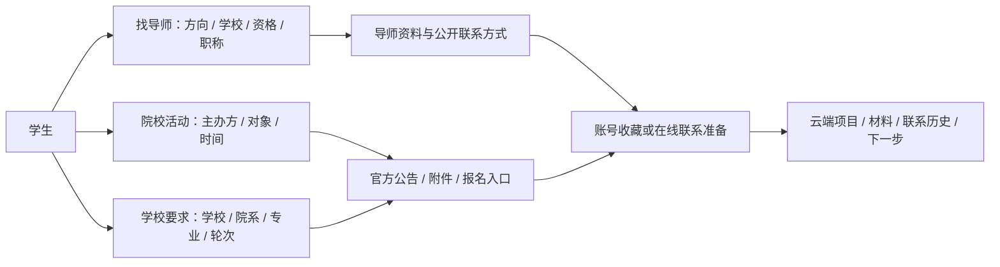
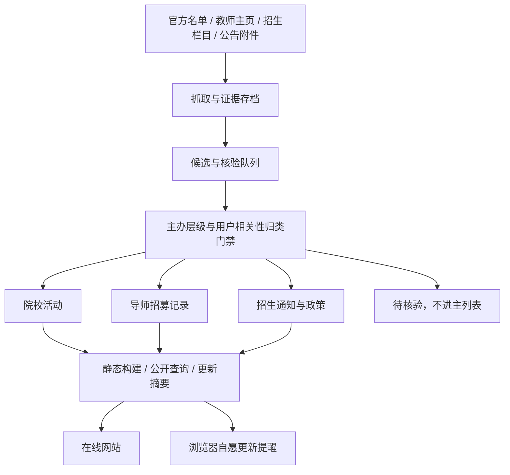

# 项目地图

2026-11-23 修订，当前版本 v1.12.4。学生可免登录浏览，用账号跨设备保存申请资料。导师资料补齐和来源核验由服务器持久任务执行。真实新增联系方式、政策发布与当前院校活动分别计数。[在线服务说明](docs/ONLINE_SERVICE.md) · [v1.12.4 交付记录](deploy/DELIVERY_V1.12.4_2026-11-23.md)

## 产品究竟服务什么任务

CS 学生需要完成三类决定：找谁联系、参加什么院校活动、为哪个学校/专业准备什么。系统负责提供能追溯的公开事实，并保存用户明确操作的申请进展。采集数量、后台功能数量、测试通过数量不代替这三个任务的完成。

图中导师筛选与活动边界已在v1.10落实：目标学位和私人核验不再参与目录，个人招募从院校活动列表分出。对应规则以 [需求](REQUIREMENTS.md)、[用况](docs/USE_CASES.md) 为准。

## 页面地图

| 页面 / 用户入口 | 应承担的单一主要任务 | 当前行为与边界 | 主要实现 |
| --- | --- | --- | --- |
| 申请导航 `start.html` | 首访选路径；回访继续已关注内容 | 学校入口前置，步骤建议折叠，维护和备份按需打开 | `start.js`、`browser-library*.js`、`plan-transfer.js` |
| 找导师 `discovery.html` | 按真实导师属性找出愿意进一步了解的人 | 资格与职称独立过滤，默认可追溯邮箱，每批4位换一批，同视口卡片等高，回访恢复原批次 | `discovery.js`、`discovery-core.js`、`crawler/public_discovery.py` |
| 导师资料 `p/*.html` | 判断研究交集，取得联系人与原始依据 | 长介绍、来源和招募事实需清晰分层；个人实习招募归此 | `detail.html.j2`、`crawler/model.py` |
| 导师对比 `compare.html` | 比较已选导师的方向、资格和联系信息 | 读取失败时保留选择、可重试及返回原筛选。同院系继续原项目，跨院系联系前重新选择项目和专业范围 | `compare.html.j2`、`crawler/public_catalog.py` |
| 院校活动 `opportunities.html` | 查看学校/院系/研究所组织的营和正式院所项目 | 只显示机构活动；个人招募等旧ID说明去向；主办方、条件、时间和官方入口优先 | `opportunities*.js`、`crawler/opportunity_util.py` |
| 学校与要求 `admissions.html` | 核对当前目标条件、材料、截止与适用范围 | 保留申请目标筛选；关键限制不截断，材料及完整证据按需查看 | `admissions*.js`、`material-actions.js` |
| 招生通知 `notices.html` | 查正式招生通知及未结构化官方信息 | 显示轮次与通知阶段；候选通知不等于已核验申请条件 | `notices*.js`、`crawler/notice_util.py` |
| 联系准备 `desk.html` | 继续联系、登记回复、安排下一步 | 以当前导师和申请为上下文；从我的申请进入，保留项目与导师 | `desk.js`、`crawler/contact_util.py` |
| 我的申请 `applications.html` | 管理一次具体申请及所需材料 | 主导航统一入口，项目、材料、沟通和提醒保留同一上下文 | `workflow.js`、`crawler/workflow_util.py`、`material_task_util.py` |
| 全量目录 `index.html` | 查看完整原始目录，含缺邮箱记录 | 保留为次级核对工具，不让新用户再理解第二套主筛选 | `index.html.j2`、`data.js`、`search.js` |
| 旧套磁看板 `board.html` | 访问已有旧记录 | 与新工作流不同步；保留历史访问，退出新用户主要路径 | `board.html.j2`、outreach API |
| 我的账号 `account.html` | 注册、登录、修改密码、退出 | 私人动作登录后返回原上下文；local.html只保留在线跳转 | `account*.js`、`online_accounts.py` |
| 覆盖/版本 `coverage.html`、`release.html` | 查覆盖缺口及实际交付记录 | 次级说明，不能成为阅读正常内容的前置步骤 | coverage 数据、`release.json` |
| 维护台 `review.html` | 取证、核验、处理来源和发布 | 仅维护者使用；归类可编辑，发布前必须核对当前原句 | `review.js`、`scripts/serve_review.py` |

模板在 `site/templates/`；`site/*.html` 与 `site/p/*.html` 是构建结果，不能只手改生成文件。样式入口为 `site/ui.css`，当前仍有局部模板样式；整改围绕现有模板，不更换技术栈。

## 当前记录边界

| 边界 | 记录与权威位置 | 不应混淆成 |
| --- | --- | --- |
| 公共资料 | `data/professors/`；`admissions.yaml`、`admissions_entries.yaml`、`admissions_checks.json`；`notices.json`、`opportunities.json` | 个人满足资格、学校已收件、导师尚有名额 |
| 浏览器界面状态 | 筛选、滚动、对比与未保存表单；历史浏览器收藏待本人确认导入 | 已保存云端账号数据 |
| 云端账号记录 | `var/accounts/accounts.sqlite3` 中身份/会话/收藏；`var/users/<ID>/` 中申请、沟通、提醒与材料 | 公共事实、服务器旧私人文件或其他账号资料 |
| 维护证据 | `cache/opportunity_review.json`、`cache/policy_intake/`、`cache/policy_revalidation/`、`cache/mentor_quality/`、`data/issues/`及来源正文/附件；配置在 `sites/` | 申请人的操作步骤或学生应理解的技术台账 |

界面统一使用“收藏”“申请项目”“联系记录”“个人提醒”。旧核验/旧套磁数据保留，不要求普通学生理解所有内部对象。现有云账号隔离个人数据；原私人文件保留，不自动归属新用户。

## 信息、API 与运行地图

v1.10 已将归类门禁接入审核、发布、API、活动页和推送；既有原文与时效规则仍独立生效。`content_classification` 保存实际组织者与原句；`mentor_ids` 仅在身份核对后关联。细则见 [内容与来源规则](docs/CONTENT_RULES.md)。

| 链路 | 关键位置 | 本轮必须一致的部分 |
| --- | --- | --- |
| 导师抓取/轮转 | `sites/<school>/*.yaml`、`scripts/crawl.py`、`crawler/legacy_refresh.py` | 保留原文、字段出处；解析器/配置修复恢复旧失败，保护人工字段 |
| 资料问题治理 | `crawler/mentor_quality.py`、`data/issues/`、`cache/mentor_quality/` | 新抓取错误自动入账，解决后周期复检或新失败重开；共享邮箱撤回后不被日常解析写回 |
| 导师字段缺口 | `crawler/mentor_fields.py`、`cache/mentor_quality/field-gaps.json` | 全库扫描邮箱、纯研究方向、明确资格、职称；未检查库存和已核验问题分账，原文复用、有界轮转、官网未公开30天复看 |
| 政策证据再确认 | `crawler/policy_revalidation.py`、`crawler/admissions_util.py`、`cache/policy_revalidation/` | 版本、原句和附件完整一致才续核；保留原人工日期，历史政策不冒充本届要求 |
| 候选查询 | `/api/mentor-candidates` → `crawler/public_discovery.py`；按ID读取 → `public_catalog.py` | 邮箱/资格/职称在分页前过滤；总数、前端回退、旧偏好兼容一致 |
| 活动发现 | `sites/opportunities.yaml`、`opportunity_monitor.py`、`source_discovery.py` | 官方同机构栏目经父子来源复核可自动接入监测；栏目准入不等于活动发布 |
| 失效来源恢复 | `mentor_recovery.py`、`opportunity_recovery.py` | 按原因选择退避、官方目录发现、解析适配或人工核对；名称和独立身份依据校验，保留旧新来源证据；迁移不覆盖人工字段、不直接发布 |
| AI传输与故障分流 | `ai_transport.py`、`automatic_review.py` | 共用预算、受限流式回答、稳定错误码；服务故障与事实冲突分开处理 |
| 核验发布 | `opportunity_review.py`、`automatic_review.py`、`ai_evidence.py`、`review_queue.py` | 官方事实门禁与产品归类门禁都通过才分发；AI不能凭标题猜主办层级 |
| 更新与推送 | `run_review_pipeline.py`、`push_util.py`、`dispatch_updates.py`、`opportunity-sw.js` | 活动API、列表、更新记录、订阅推送使用同一公开范围 |
| 维护告警 | `crawler/quality_status.py`、`maintenance_push.py`、`cache/quality-alerts.json` | 连续等待不重置，缺失任务状态不报健康；维护通知与学生更新订阅分离 |
| 私人工作流 | `online_workspace.py` 按账号适配 `scripts/serve.py` 的 workflow/contact/project/material 业务 | 登录后显式保存；旧活动快照、联系人、材料和提醒不被公共更新重写 |
| 构建与发布 | `scripts/build_site.py`、`maintain_public.py`、`run_review_pipeline.py` | 源数据、索引、详情与API配套；维护不生成客户端资料ZIP，不更新账号目录 |

技术形态：Python + YAML/JSON + SQLite账号库 + Jinja2 + 原生 JS，多页站点。`scripts/serve_public.py` 提供 HTTPS 8443，HTTP80跳转；维护台仅监听 loopback 18769。`scripts/serve.py` 保留业务代码和内部开发用途，不是学生服务入口。部署约定及凭据边界见 [架构](ARCHITECTURE.md) 和 [交接](HANDOVER.md)。

## 数据和验证现状

公开数据数量和已整理缺口见 [数据快照](docs/DATA_SNAPSHOT.json) 与网站覆盖页；每条资料以自身来源、适用年度和核验时间为准，构建日期不能证明整库已刷新。2026-11-15整改前的字段质量与18条混合内容处置依据保留在 [历史问题审计](docs/PRODUCT_AUDIT_2026-11-15.md)。

v1.11.4 候选资料的专项结果：机会监测配置 74 项；原 30 条积压政策完成证据再确认，现有 111 条均为 2027 年度；原 67 条资料问题解决 46 条、保留 21 条。新增栏目中的历史公告不计作当前机会，本轮没有新增可确认面向 2028 届的正在报名项目。逐条证据见[政策](docs/audits/2026-11-16/policy-revalidation.md)、[导师](docs/audits/2026-11-16/mentor-quality.md)和[来源](docs/audits/2026-11-16/opportunity-sources.md)。首次生产自动扫描可能发现原台账之外的新问题，须另计。

v1.11.5 对随后暴露的419条积压完成逐项处理（原411、新增8）：155条恢复，264条保留明确原因和后续动作；103条实际迁移到核验过的官方来源。AI传输、目录发现、名册翻页及故障退避改进的证据分别见[资料台账](docs/audits/2026-11-16-v1115/backlog.md)和[AI诊断](docs/audits/2026-11-16-v1115/ai-reliability.md)。当期活动没有新增足够证据可发布的2028届项目，不能把目录发现数作为机会数。

Python 和 Node 测试覆盖规则、范围、存储、分页和发布边界。真实 HTTPS 浏览器验收覆盖注册登录、导师转接、建立申请、上传下载和沟通记录。账号首次上线和本轮验证分别记录在[v1.11 交付](deploy/DELIVERY_V1.11_2026-11-15.md)及[v1.12.4 交付](deploy/DELIVERY_V1.12.4_2026-11-23.md)。

## 文档阅读顺序

1. 本地图：系统有什么、问题在哪里。
2. [产品计划](PRODUCT_PLAN.md) → [需求](REQUIREMENTS.md) → [用况](docs/USE_CASES.md)：为谁解决什么问题。
3. [内容规则](docs/CONTENT_RULES.md) → [UI规则](docs/UI_GUIDELINES.md)：内容准入、来源和呈现口径。
4. [实施计划](IMPLEMENTATION_PLAN.md)：四阶段顺序、改动边界、验收与回滚。
5. [架构](ARCHITECTURE.md)、[交接](HANDOVER.md)、[在线使用手册](USER_GUIDE.md)：现有运行事实。

旧通用计划已原字节归档到 `docs/history/pre-ux-reset-20261115/`，日期命名的其他历史交付保留，不作为当前计划。

## 在线服务新增落点

- `scripts/serve_public.py`：HTTPS账号与私人API门禁、HTTP跳转及旧下载下线。
- `crawler/online_accounts.py`：用户、会话、限流和带版本的账号收藏。
- `crawler/online_workspace.py`：原申请业务的按账号适配，不暴露原本机接口。
- `crawler/online_materials.py`：上传、下载、配额、路径与材料引用保护。
- `site/account-session.js`、`account.js`、`cloud-library.js`：会话、登录返回和云端收藏。

## v1.11.6现有流程收敛

审核前先按有效官方证据分流历史与栏目入口；活动附件和报名链接纳入同一版本门禁。新政策从已登记通知进入独立持久队列，通过完整证据、AI交叉核对和发布前回源后追加入库。完整语义变化、复杂附件与同范围冲突保留维护处理。导师名册持续续扫并保留候选，不自动新增身份不清的人物。

首访申请导航与找导师将必要样式/启动脚本内联，账号状态仍从在线API取得；院校活动正常只请求一次在线目录，API异常才降级到静态副本并标记来源未确认。学校要求先载入院校目录，按所选学校读取完整政策、材料与证据，原文继续按需展开。真实公网连接与页面加载分开测量，不能以请求数减少代替访问速度验收。
