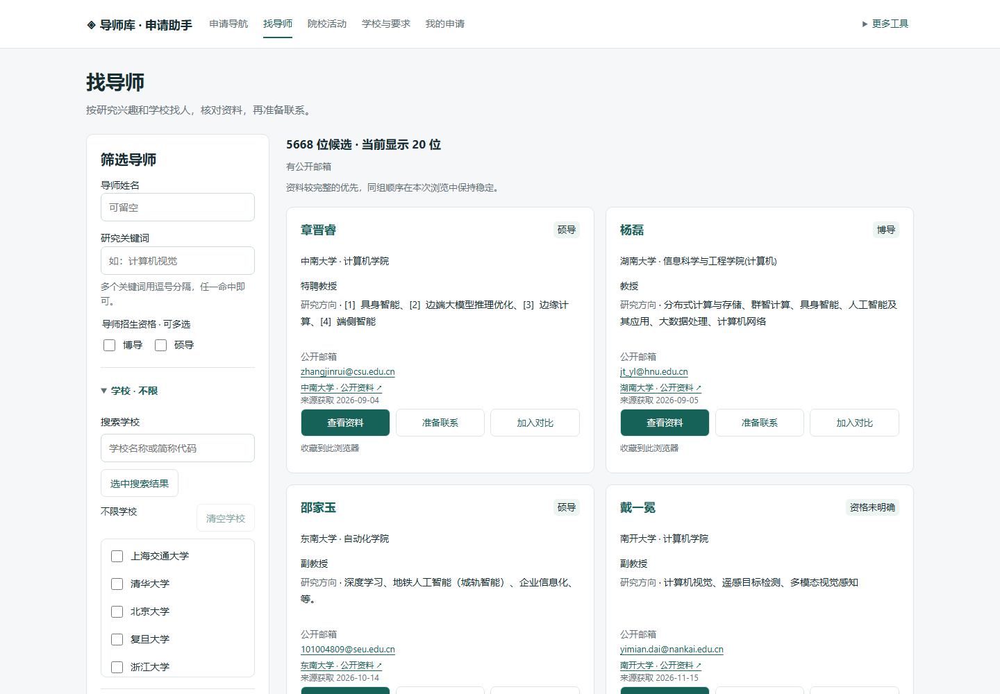
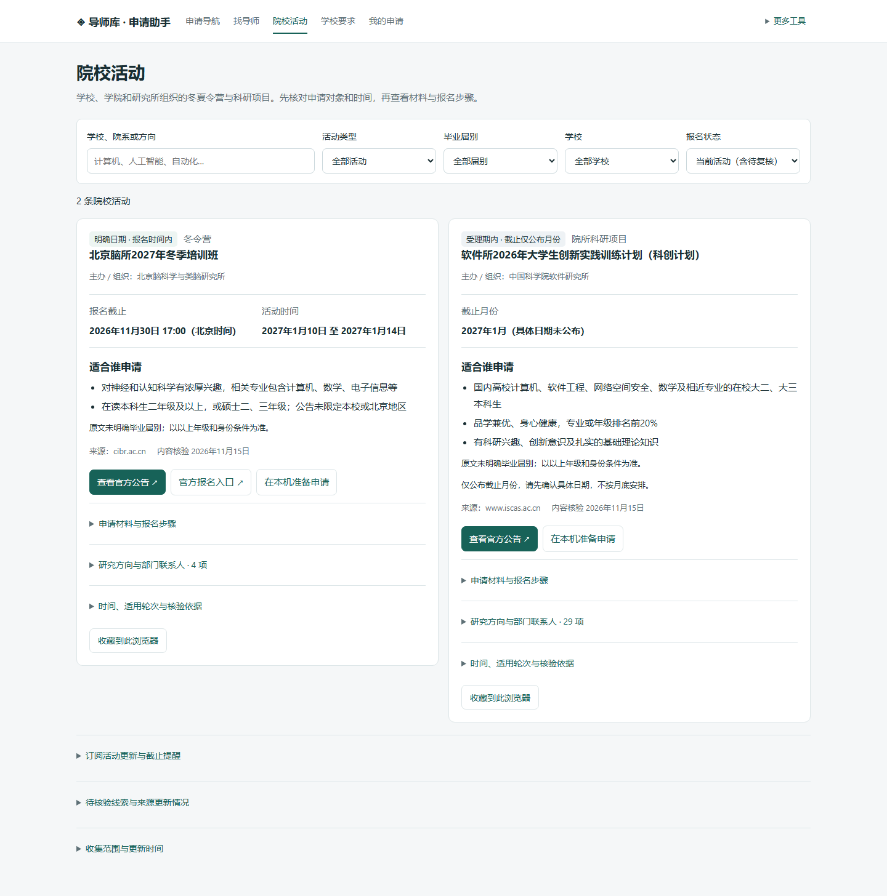

# v1.10 收敛验收证据

2026-11-15。以下为内部验证，不代表用户已验收，也不证明公开资料完整或实时。

| 需求 | 实现与验证 |
| --- | --- |
| R-C01 / R-C04 | 18条旧记录分为9机构活动、6导师招募、1正式通知、2待核验；7条活动为历史。活动列表和API不再混入个人招募。 |
| R-C02 | 招募独立保存并有身份依据。董谨豪已关联；其余5条无法可靠匹配现有导师，保留待关联与旧链接，不猜测。 |
| R-C03 | 审核、自动核验、发布、API、更新和推送使用统一分类门禁；未分类拒绝。维护页可填写组织者与原句，保存与重新取证发布分开。 |
| R-S01 / R-S02 / R-S03 | 列表展示具名主办方、官方出处、整理日期和全部适用限制；材料、联系人角色和完整证据折叠。未确认的毕业届别不推算。 |
| R-M01 / R-M03 / R-M04 | 博导／硕导并集、正式职称分类，旧学位/年/渠道/匹配规则不参与导师目录。原私人核验记录与API保留。 |
| R-M02 | 默认邮箱格式与来源同时满足，共5668位；显式放宽后7173位。29项修正依既有官方HTML，保留原抓取日。 |
| R-M05 / R-P01 | 8组全量前后端计数与前20顺序一致；首20、失败保留、版本变化重置、API503回退、40位与原导师位置恢复。 |
| R-U01 | 20张混合卡同视口尺寸差≤1 CSS px，桌面和手机均384px高；长姓名、无方向、招募标签等覆盖，底部操作对齐。 |
| R-U02 / R-A01 | 14页面共享字体与控件规则；学校页保留年度/学位/渠道；320px导航不粘连，收藏控件字体修正到13px。 |
| R-A02 | 实际公开卡→本机说明→隔离本机导师联系→项目材料→返回原导师与找导师；合法目标保留，私人参数不透传。 |
| R-P02 | 迁移幂等，保留稳定ID/旧申请快照；测试使用隔离私人目录。服务器保护清单7326项仅出现允许的迁移变化。 |
| R-D01 | 654项pytest、14组Node；内容、布局与任务走查分别记录。四阶段最终结果见交付记录。 |

用况 UC-01/02/03 见 [discovery.json](discovery.json) 与 [全量一致性](discovery-parity.json)；UC-04/05/09/10 见 [content.json](content.json)、[activity-ui.json](activity-ui.json)、[review-ui.json](review-ui.json)；UC-06/07/08 见 [handoff.json](handoff.json)、[system-ui.json](system-ui.json)。私人材料、沟通与提醒的已有存储约束还由完整回归覆盖；没有执行真实发送或替用户提交。

[汇总](RESULTS.json) · [窄屏检查](breakpoints.json) · [交付记录](../../../deploy/DELIVERY_V1.10_2026-11-15.md)

人工查看过导师、活动、学校和本机流程截图。200%检查使用720 CSS px、2倍设备比例模拟1440物理宽度的布局，未声称操作了浏览器原生缩放工具栏。`activity-ui.json`中的`screenshots_reviewed=false`是自动脚本不替人工声明，人工观察另在本说明中记录。

手机图：[导师](mentor-mobile.png) · [学校要求](school-mobile.png)。实际交付前公网两尺寸重新检查，见交付记录。
